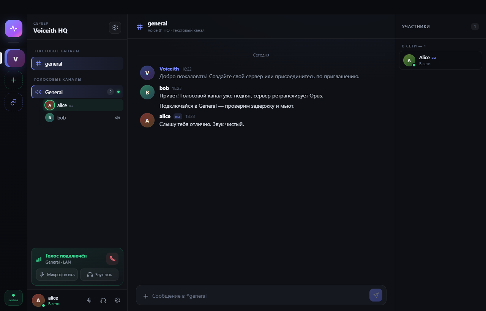
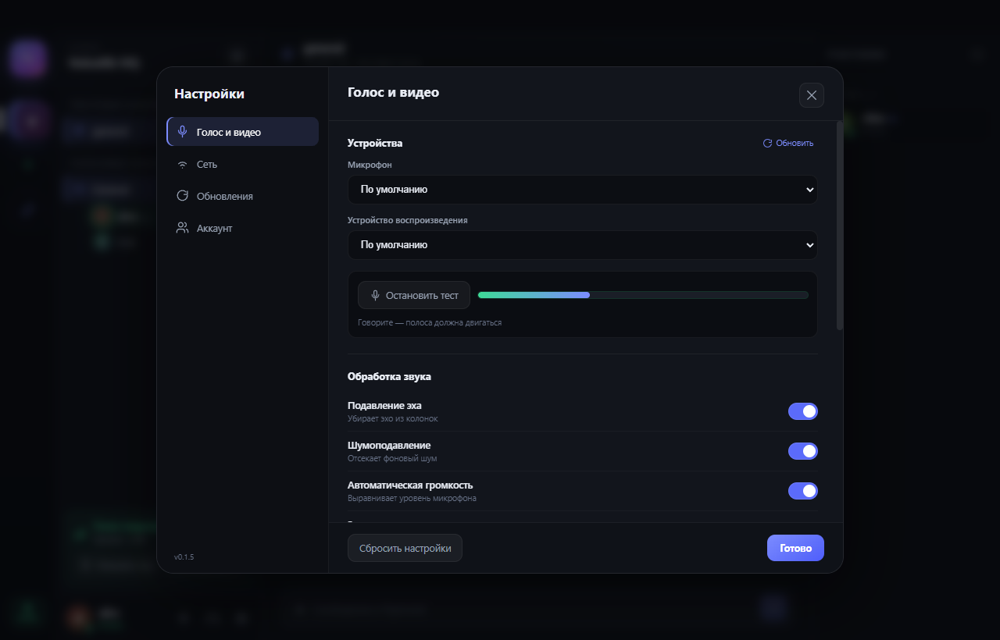
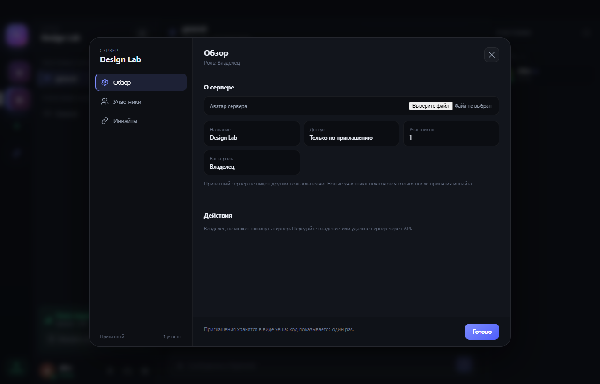
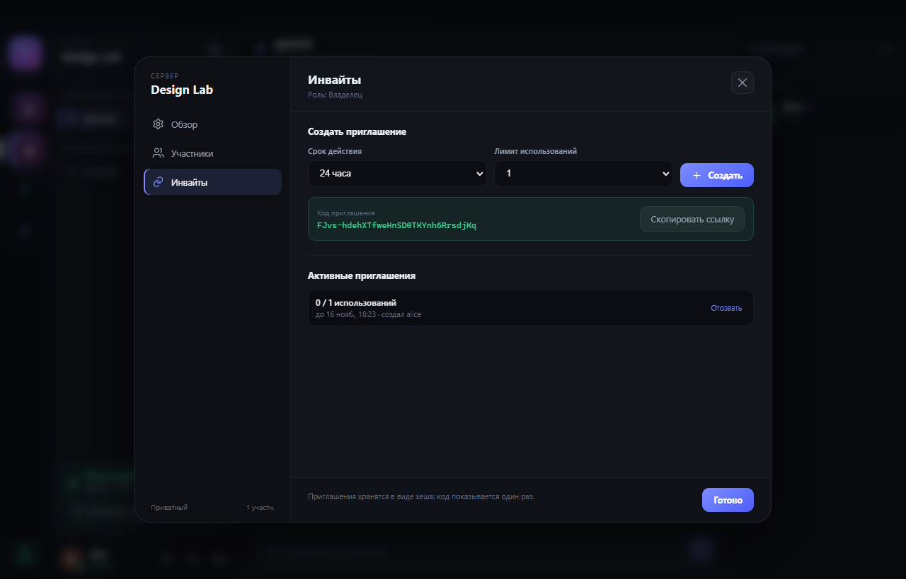
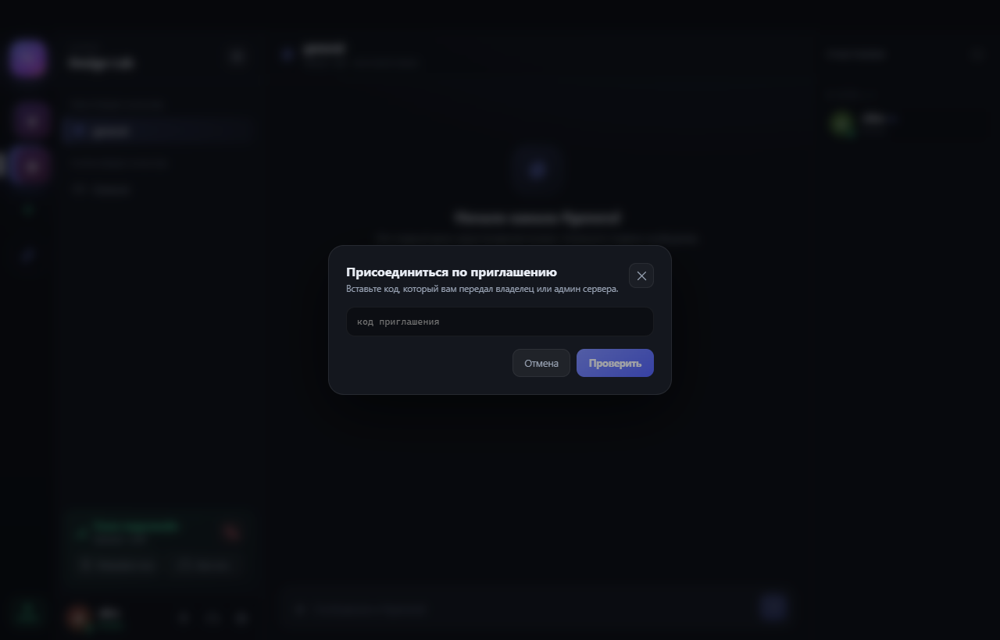
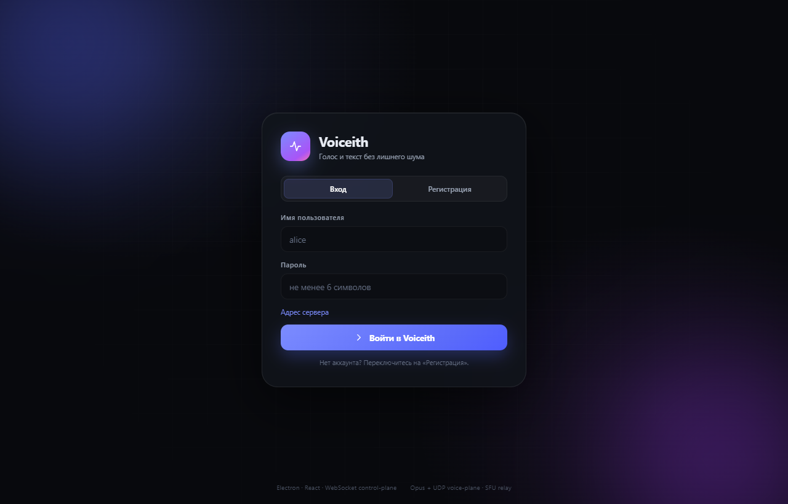

<div align="center">


# Voiceith

**Приватный голос и текст для команд — без сторонних SDK и облачных посредников.**

Windows · Linux · macOS · Android

[](https://github.com/Alegafrenn/voiceith-releases/releases/latest)
[](https://github.com/Alegafrenn/voiceith-releases/releases/latest)
[](https://github.com/Alegafrenn/voiceith-releases/releases/latest)
[](https://github.com/Alegafrenn/voiceith-releases/releases/latest)
[](https://github.com/Alegafrenn/voiceith-releases/releases/latest)

</div>

---

## Скриншоты

<div align="center">
  
</div>

<div align="center">
  
  
</div>

<div align="center">
  
  
</div>

<div align="center">
  
</div>

## Скачать

Все сборки лежат в разделе **[Releases](https://github.com/Alegafrenn/voiceith-releases/releases/latest)**.

| Платформа | Файл | Установка |
|---|---|---|
| **Windows 10/11 x64** | `Voiceith-Setup-<version>.exe` | Запустить installer. Установка per-user, без администратора. |
| **Linux x64** | `Voiceith-<version>-x86_64.AppImage` | `chmod +x` и запустить. |
| **Debian / Ubuntu** | `Voiceith-<version>-amd64.deb` | `sudo apt install ./Voiceith-<version>-amd64.deb` |
| **macOS 11+ Intel** | `Voiceith-<version>-x64.dmg` | Открыть DMG, перетащить в Applications. |
| **macOS 11+ Apple Silicon** | `Voiceith-<version>-arm64.dmg` | Открыть DMG, перетащить в Applications. |
| **Android 10+** | `Voiceith-Android-<version>.apk` | Разрешить установку из неизвестных источников и открыть APK. |

В Release также публикуются:

- `latest.yml` — манифест автообновления Windows/Linux desktop;
- `latest-mac.yml` — манифест автообновления macOS;
- `*.blockmap` — дифференциальное обновление;
- `.AppImage` и `.deb` для Linux;
- `.dmg` и `.zip` для macOS;
- release notes с изменениями версии.

> macOS-сборки сейчас **unsigned**. Gatekeeper будет предупреждать при запуске. Пользователь может открыть приложение через «Правый клик → Открыть» или выполнить `xattr -cr /Applications/Voiceith.app`.

> Android APK может быть подписан debug-ключом до перехода на release keystore. Для публичного распространения будет использоваться отдельная подпись.

## Что умеет Voiceith

- **Серверы и каналы** — текстовые и голосовые комнаты.
- **Правая панель участников** — все участники сервера с разделением «В сети» и «Не в сети».
- **Приватные серверы** — видны только участникам, вход по инвайтам.
- **Инвайт-ссылки** — `voiceith://invite/<code>`, копирование и открытие в приложении.
- **Роли** — owner / admin / member, проверка прав на сервере.
- **Голос** — Opus 48 кГц, UDP-ретрансляция через SFU-lite, STUN, jitter-буфер.
- **Громкость участников** — отдельная громкость для каждого собеседника.
- **Push-to-talk** — клавиша на desktop и экранная кнопка на Android.
- **Шумовой гейт** — не отправляет тишину и фоновый шум.
- **Настройки** — выбор микрофона и устройства вывода, тест микрофона, усиление до 300%, VU-индикатор.
- **Статусы** — «В сети», «Не активен», «Не беспокоить»; выбор по клику на аватарку.
- **Аватары** — пользователей и серверов, синхронизация в чате и списке участников.
- **Уведомления** — звуки входа в голос, новых сообщений и упоминаний; системные уведомления.
- **Desktop** — трей, installer, автообновление, online-индикатор в rail.
- **Android** — native UDP/Opus, foreground service, mobile drawer.
- **Reconnect** — восстановление сессии и голосового канала после обрыва связи.

## Быстрый старт

### Windows

1. Скачайте `Voiceith-Setup-<version>.exe`.
2. Запустите installer.
3. Откройте Voiceith, введите имя пользователя и пароль.
4. Укажите адрес сервера, если он отличается от значения по умолчанию.
5. Создайте сервер или присоединитесь по инвайту.

Данные клиента: `%LOCALAPPDATA%\Voiceith`.

### Linux

AppImage:

```bash
chmod +x Voiceith-<version>-x86_64.AppImage
./Voiceith-<version>-x86_64.AppImage
```

Debian/Ubuntu:

```bash
sudo apt install ./Voiceith-<version>-amd64.deb
```

Данные клиента: `~/.config/Voiceith`.

### macOS (Intel и Apple Silicon)

1. Определите процессор:
   - меню Apple → **Об этом Mac**;
   - `M1/M2/M3/M4` — Apple Silicon, скачивайте `arm64`;
   - `Intel` — скачивайте `x64`.
2. Скачайте нужный DMG:
   - `Voiceith-<version>-arm64.dmg`;
   - `Voiceith-<version>-x64.dmg`.
3. Откройте DMG и перетащите **Voiceith** в папку `Applications`.
4. Откройте **Applications**, нажмите правой кнопкой по **Voiceith** → **Открыть** → **Открыть**.
5. Если macOS блокирует запуск:
   - **Системные настройки → Конфиденциальность и безопасность**;
   - внизу нажмите **«Всё равно открыть»** для Voiceith.
6. Альтернатива через Terminal:

```bash
xattr -cr /Applications/Voiceith.app
open /Applications/Voiceith.app
```

Можно использовать и `.zip`-сборку: распакуйте, перенесите `Voiceith.app` в `Applications` и выполните те же шаги.

> macOS-сборка **unsigned**. Это значит, что Gatekeeper будет предупреждать при первом запуске. Нотаризация Apple появится позже.

Данные клиента: `~/Library/Application Support/Voiceith`.

Удаление:

1. Перетащите `Voiceith.app` из `Applications` в корзину.
2. При необходимости удалите данные:
   ```bash
   rm -rf "$HOME/Library/Application Support/Voiceith"
   ```

### Android

1. Скачайте `Voiceith-Android-<version>.apk`.
2. Разрешите установку из неизвестных источников.
3. Установите и откройте приложение.
4. Разрешите доступ к микрофону и уведомлениям.
5. Войдите и подключитесь к голосовому каналу.

Для фонового голоса Android показывает постоянное уведомление foreground service. Не отключайте его, если хотите оставаться в канале при заблокированном экране.

## Автообновление

Desktop-версии проверяют обновления через GitHub Releases:

- при запуске;
- каждые несколько часов;
- вручную из **Настройки → Обновления** или из трея.

Обновление скачивается в фоне, проверяется по SHA-512 и устанавливается после перезапуска. Данные и настройки сохраняются.

Android-обновления пока устанавливаются вручную из APK. Публикация в Google Play/RuStore — отдельный этап.

## Каналы

| Канал | Назначение |
|---|---|
| **Stable** | Обычные релизы. Рекомендуется всем пользователям. |
| **Beta** | Ранние сборки для тестирования. Может быть нестабильно. |

Канал выбирается в **Настройки → Обновления**.

## Что нужно для работы

Клиент — это только часть системы. Для голоса и текста нужен запущенный **Voiceith server**:

- control-plane: WebSocket;
- media-plane: UDP;
- SQLite для пользователей, серверов, инвайтов и сообщений.

Сервер не входит в этот репозиторий и не устанавливается вместе с клиентом. Адрес сервера указывается на экране входа или в настройках.

Для голоса должны быть доступны:

- TCP-порт control-plane (обычно `8080`);
- UDP-порт voice-plane (обычно `50000`).

Если UDP недоступен, текст будет работать, а голос — нет.

## Проверка и подпись

- Desktop-обновления используют SHA-512 из `latest.yml`.
- Windows installer может быть не подписан до получения Authenticode-сертификата; SmartScreen может показать предупреждение.
- Android APK подписывается отдельным keystore; до релиза может использоваться debug-подпись.
- Linux AppImage/deb не имеют встроенной подписи; проверяйте SHA-256 в описании релиза.

## Troubleshooting

**Windows: SmartScreen предупреждает**
Нажмите «Подробнее» → «Выполнить в любом случае». Это ожидаемо для unsigned-сборки.

**Linux: AppImage не запускается**
Проверьте права:

```bash
chmod +x Voiceith-*.AppImage
```

Если не хватает FUSE:

```bash
sudo apt install libfuse2
```

**macOS: Gatekeeper блокирует запуск**
Сборка unsigned. Откройте через «Правый клик → Открыть» или выполните:

```bash
xattr -cr /Applications/Voiceith.app
```

Если macOS пишет «повреждено», проверьте архитектуру DMG: `x64` для Intel, `arm64` для Apple Silicon.

**Android: APK не устанавливается**
Разрешите установку из неизвестных источников для файлового менеджера или браузера. Удалите старую debug-версию, если подпись изменилась.

**Нет звука**
Проверьте:

- разрешение на микрофон;
- выбранное устройство ввода/вывода;
- mute/deafen;
- доступность UDP-порта сервера;
- не включён ли PTT без удержания клавиши.

**Меня не слышат**
Проверьте микрофон в **Настройки → Голос → Проверить микрофон**. Если уровень не двигается, выберите другое устройство.

**Не приходят обновления**
Убедитесь, что установлена версия из этого репозитория, а не dev-сборка. Проверьте канал Stable/Beta и наличие `latest.yml` в последнем Release.

## Безопасность

Voiceith не использует Discord/Slack/Telegram SDK и не отправляет голос в сторонние облака. Голос идёт через ваш сервер по UDP; для интернета рекомендуется TLS/WSS и WireGuard/TURN.

Если вы нашли уязвимость, не создавайте публичный issue. Свяжитесь с владельцем репозитория.

## Об этом репозитории

Здесь публикуются **только собранные артефакты и release notes**. Исходный код находится в приватном репозитории и не распространяется через `voiceith-releases`.

- Pull requests с кодом не принимаются.
- Для доступа к приложению и серверу обратитесь к владельцу.
- Старые версии остаются в Releases для отката.

## Стек

`Electron` · `React` · `Vite` · `Node.js` · `WebSocket` · `UDP` · `Opus` · `SQLite` · `Capacitor`

---

<div align="center">

Сделано для приватных команд, которым нужен свой голосовой сервер.

</div>